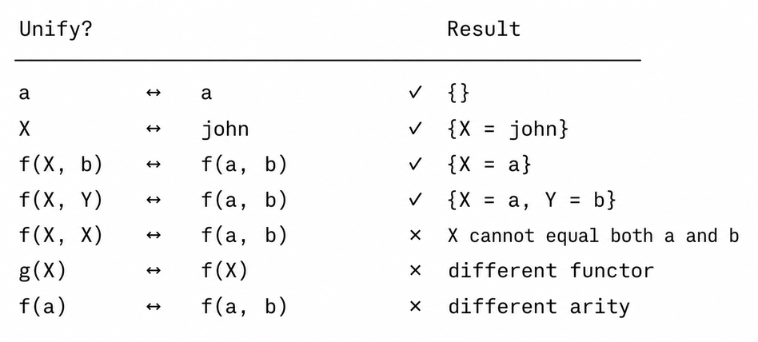
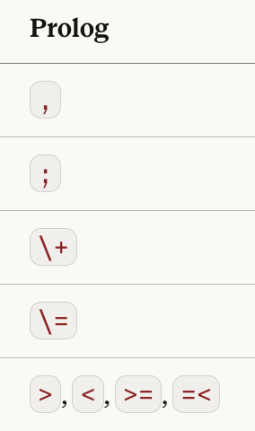
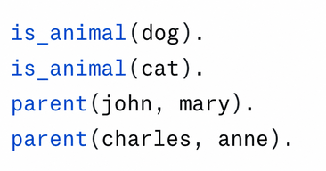
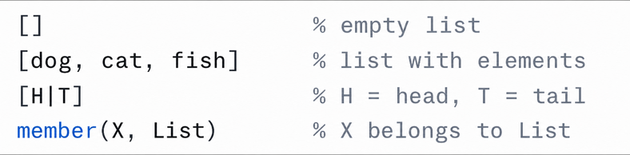

<!--
Week 8 Session A. Mini-lecture budget: 25 minutes.
Source: 05_Planning.pptx slides 10-13. Beats per lesson plan: FOL syntax/
semantics (6) → unification (8) → MGU (2) → forward vs. backward chaining (7,
NOT in the source deck) → declarative programming (2).
Lesson plan: ../../weeks/week-08.md
-->

# First-Order Logic, Unification, and Prolog

## One sentence instead of thirty

**CMP-4004** · Week 8

---

# What FOL adds

| | Propositional | First-order |
|---|---|---|
| Objects | ✗ | **constants, variables, functions** |
| Relations | one symbol per tuple | **predicates of any arity** |
| Quantifiers | ✗ | **∀, ∃** |
| "Every student who passes graduates" | 30 sentences for 30 students | **one sentence** |
| Decidable? | **yes** | **semi-decidable** |

That last row is the price. If `KB ⊨ α`, you will eventually find a proof. If
not, the search **may never halt.**

State that precisely — it is a permanent limitation, not an implementation defect.

---

# Predicates return truth. Functions return objects.

The distinction students get wrong most often:

| Expression | Is a… |
|---|---|
| `Father(john)` | **object** — the person who is John's father |
| `IsFather(john, mary)` | **proposition** — true or false |

Mixing them produces sentences that are not even well-formed, and Prolog will
accept some of them silently.

---

# Quantifier scope changes the meaning

## `∀x ∃y Loves(x, y)`

Everyone loves someone — **possibly a different someone each time.**

## `∃y ∀x Loves(x, y)`

**One particular person** is loved by everyone.

Order matters, and the difference is not subtle.

### The pairing rule to memorize

- `∀` goes with `→`
- `∃` goes with `∧`

`∀x (Student(x) ∧ Passes(x))` claims **everything in the universe** is a passing
student. This is the single most common FOL error.

<!--
6 min for the three FOL slides. Put the quantifier-scope error on the board as a
sentence students would plausibly write. In the studio, "quantifier scope wrong"
is the most common AND most damaging arm-B translation error — plant it now so
they recognize it when they see it in their own data.
-->

---

# Unification


The process by which Prolog attempts to make two terms **syntactically identical**
through variable substitution. It is the mechanism that lets Prolog "resolve"
variables in a query.

- A **substitution** is a set of assignments `variable → term`:
  `{X = john, Y = mary}`
- Two terms **unify** if some substitution makes them identical
- The **most general unifier (MGU)** is the minimal such substitution — it assigns
  no more than necessary

**Why minimal?** A more specific substitution silently discards solutions.

---

# The rules of unification



Terms `t₁` and `t₂` unify if at least one holds:

1. **Both the same constant** — `a` unifies with `a`, substitution `{}`
2. **One is a variable** — `X` unifies with any term `t` → `{X = t}`.
   *If X already has a value, that value must unify with t.*
3. **Both compound** — they unify if they have
   - the same **functor** (predicate/function name)
   - the same **arity**
   - arguments that all unify **recursively**

### 4 · The rule the deck omits: the occurs check

**`X` does not unify with `f(X)`.**

Omitting it produces infinite terms — and is why standard Prolog is technically
**unsound**. Prolog omits it *for speed*: a real engineering trade-off in a system
you are about to use.

---

# Unification by hand

| p | q | Result |
|---|---|---|
| `Knows(john, X)` | `Knows(john, mary)` | `{X = mary}` |
| `Knows(john, X)` | `Knows(Y, mother(Y))` | `{Y = john, X = mother(john)}` |
| `Knows(john, X)` | `Knows(mary, Z)` | **fail** |
| `f(X, a)` | `f(b, X)` | **fail** — X cannot be both |
| `X` | `f(X)` | **fail**, *with* the occurs check |

<!--
8 min for the three unification slides. Work these live; the failures teach more
than the successes. Row 4 is the one students get wrong.
Mention that unification is the same operation behind type inference and pattern
matching — students who have used Rust or Haskell will recognize it.
-->

---

# Resolution and backtracking



**Robinson (1965):** resolution is a **single** inference rule, and it is
**refutation-complete** for FOL. Contrast with week 7's pile of rules — one rule
means one correctness argument and one implementation.

In Prolog, every query triggers a **unification + backtracking** cycle:

1. Try to unify the query with the **head of each clause**, top to bottom
2. If unification succeeds, substitute variables and test the **rule body**
3. If the body fails, **backtracking** undoes the substitution and tries the next
   clause
4. If no clause unifies, the query **fails**

---

# Forward vs. backward chaining

<!--
This content is NOT in the source deck. It is the week's main addition, and
Checkpoint 2 asks which to use for a given workload.
-->

| | **Forward chaining** | **Backward chaining** |
|---|---|---|
| Direction | facts → conclusions | goal → subgoals |
| Driven by | **data** | **query** |
| Derives | everything derivable | only what is relevant |
| Good when | few facts, many queries | many facts, specific query |
| Used by | production / expert systems | **Prolog** |
| Risk | derives irrelevant facts | **infinite loops** on left recursion |

*"What can this student take now?"* → backward, query-driven.
*"What can everyone take?"* → forward, derive-everything.

<!--
7 min. Derive the SAME conclusion both directions on one small KB. The infinite
loop in the last row is not hypothetical — students hit it in the studio, and
the live-coding block breaks ancestor/2 on purpose.
-->

---

# Prolog



A **declarative** language based on first-order logic.

# `Algorithm = Logic + Control`

**You supply the logic. Prolog supplies the control.**

| | |
|---|---|
| **Facts** | unconditional statements — truths about the domain |
| **Rules** | conditional knowledge |
| **Queries** | questions Prolog answers by searching the KB |

The fundamental difference from Python: **the programmer defines a knowledge
base; Prolog performs the search.** You describe what is *true* about the
problem, not how to compute it.

<!--
This corrects the week-1 slide: Prolog is Colmerauer & Roussel, Marseille 1972,
and it is DECLARATIVE. The source deck 01 slide 9 says "Dennis Ritchie at Bell
Labs" and "imperative, compiled" — both wrong. If you did not correct it in week
1, correct it here.
-->

---

# Syntax



| Form | Meaning |
|---|---|
| `atom` (lowercase) | concrete values, constants |
| `Variable` (uppercase) | unifies with any value |
| `_` (anonymous) | a variable whose value we discard |
| `,` | **AND** |
| `;` | **OR** |
| `\+` | **NOT** (negation as failure) |
| `\=` | **not unifiable** |

```prolog
parent(tom, bob).      parent(bob, ann).      parent(bob, pat).
male(tom).             male(bob).             female(ann).

father(X, Y) :- parent(X, Y), male(X).
grandparent(X, Z) :- parent(X, Y), parent(Y, Z).
ancestor(X, Y) :- parent(X, Y).
ancestor(X, Y) :- parent(X, Z), ancestor(Z, Y).
```

---

# The promise and its limit

## The promise — relations run backwards

```prolog
?- father(X, ann).     % who is Ann's father?
X = bob.

?- father(bob, X).     % who are Bob's children?
X = ann ; X = pat.
```

**One clause answers both questions.** There is no Python equivalent this short.

## The limit — reorder two goals and it hangs

```prolog
ancestor(X, Y) :- ancestor(X, Z), parent(Z, Y).   % ← left recursion
```

**The logic is identical. The control is broken.**

> `Algorithm = Logic + Control` cuts both ways: when the control is wrong, you
> must think procedurally after all — clause order, `cut`.

<!--
2 min. The reversible-father demo is the moment Prolog clicks for imperative
programmers. Do not rush it. Then break it — the hang is the honest limitation
of declarative programming and students should see it from you, not at 11 pm.
Also revisit the week-7 animal taxonomy here: isa(bluebird, bird),
hasproperty(bird, flies), and write the inheritance rule in one line.
-->

---

# LINC — the same architecture, third time

Olausson et al. (2023): the LLM is a **semantic parser** into first-order logic;
inference is offloaded to a **theorem prover**.

| Week | Generator | Verifier / engine |
|---|---|---|
| 6 | LLM → CSP | your CSP solver |
| 7 | LLM → CNF | DPLL |
| **8** | **LLM → FOL** | **theorem prover / Prolog** |
| 9 | LLM → PDDL | classical planner |

**Why did independent groups converge on this?** Because it puts each component
where its strength is. **Convergent design is evidence.**

---

# Next

## Live coding

1. `unify()` in Python — then **delete the occurs check** and watch
   `unify(X, f(X))` build a cyclic term. A two-line unsoundness demo.
2. `swipl` live: the family KB, `trace.` on `ancestor(tom, ann)`, then break it
   with left recursion.

## Studio — three arms over 20 FOL inference problems

| Arm | Pipeline |
|---|---|
| A | hand-translate to Prolog → `swipl` |
| B | LLM translates to Prolog → `swipl` |
| C | LLM answers directly |

**"No answer" is a legitimate third outcome this week**, not a bug — that is
semi-decidability, and it belongs on scorecard axis 8.

Classify every arm-B translation error: quantifier scope · `∀` with `∧` ·
inconsistent arity · hallucinated premises · missing premises.
